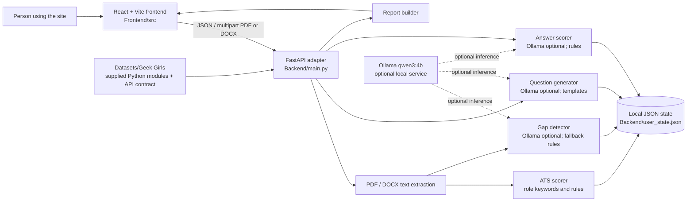

# CareerSage system architecture and workflow

## Components

## Main workflow

1. The person registers or logs in through the frontend. The FastAPI backend checks credentials and saves account records locally with salted PBKDF2 password hashes.
2. The person selects a role and uploads a PDF or DOCX resume. The backend extracts text, computes ATS/role keyword scores, detects skill gaps, and stores the source text and analysis in the local state file.
3. The frontend requests the user's dashboard. Resume score, skills, role matches, preparation suggestions, and interview progress are populated from that user's latest stored analysis and scored answers.
4. Interview practice asks the backend for questions based on the selected role and detected gaps. Scored responses update session state and feed the report.
5. The report builder combines resume analysis, gaps, and interview feedback. The frontend turns the response into a plain-language report for viewing or download.

## Interfaces and persistence

- Frontend base URL: `VITE_API_BASE_URL` (local default `http://127.0.0.1:8000`).
- Authentication: `POST /auth/register`, `POST /auth/login`.
- Resume analysis: frontend adapter `POST /resume/analyze`; contract endpoint `POST /analyze-resume`.
- Dashboard and practice: `GET /dashboard`, `POST /generate-questions`, `POST /score-answer`, `POST /report`.
- Analysis modules live separately in `Datasets/Geek Girls/` and are imported by the backend at startup.
- Local accounts and resume/interview state persist in `Backend/user_state.json`. It contains personal data and is deliberately excluded from release bundles.
- Ollama and `qwen3:4b` are optional. Rule-based and template fallbacks support core workflows without a running model.

## Boundaries

The supplied analysis modules contain fixed role keyword lists and rule/template logic; the project does not include a separate corpus for training a custom model. The local JSON store is suitable for a prototype on one trusted machine, not a multi-user production deployment. See `WEEK_3_DELIVERABLES_REVIEW.md` for test evidence, measured build size, and remaining work.

